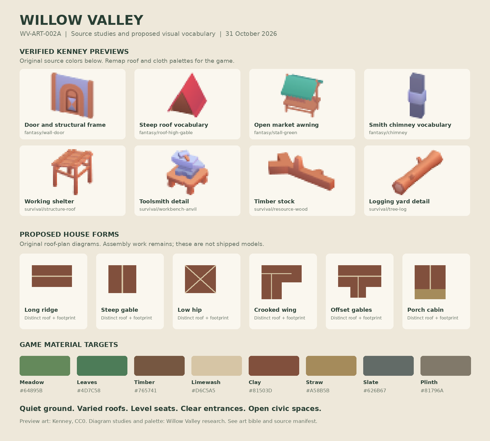

# WV-ART-002A: Willow Valley art bible

**Decision:** a warm, inhabited valley settlement with hand-built timber and plaster architecture, subdued roofs, irregular frontage, and readable workplaces. Extends [WV-ART-001](WV-ART-001-seamless-3d-world.md) and the [approved handoff](../handoffs/WV-3D-2026-10-31-work-codex.md). Research dated 2026-10-31; no new gameplay is authorized.

The board separates **verified kit previews** from **proposed house silhouettes**. Its palette and house arrangements are original direction studies. It contains no copied Foundation, Outlanders, or CityRT artwork. Review at normal mobile zoom before adding close-up detail.

## Historical vocabulary and its limits

Willow Valley is a fictional evolving settlement, not a reconstruction of Cádiz or a dated English village. Cádiz informs angled streets and accumulated irregular plots; English vernacular references inform timber, plaster, roof massing, and agricultural working spaces. Do not combine Mediterranean urban density and a northern timber hamlet as if they were one documented historical site.

[English Heritage's medieval architecture overview](https://www.english-heritage.org.uk/learn/story-of-england/medieval/architecture/) describes timber use across domestic and agricultural construction. Its [Leigh Court Barn history](https://www.english-heritage.org.uk/visit/places/leigh-court-barn/History/) supplies a useful structural reference for timber rising from a stone plinth. Translate those observations into clearly expressed posts, restrained infill panels, and a continuous load-bearing seat. Do not copy an individual heritage building's plan or photographs.

A [Historic England granary listing](https://historicengland.org.uk/listing/the-list/list-entry/1347830) describes a seventeenth-century timber-framed, boarded granary with upper doors. This supports an intelligible storage silhouette, but does **not** establish that exact building as early medieval. Our raised storage platform is a gameplay-readable art convention with a later vernacular reference. Label the founding commons, plaza, toolsmith, and log yard as fictional functional interpretations, not historically certified institutions.

## Material and color specification

These hex values are proposed **sRGB art swatches**, not replacements for existing linear vertex values. Convert once through Three.js color management. Keep the existing landscape palette recognizable; calibrate by side-by-side screenshots. Do not reinterpret all old decimal RGB values as sRGB without checking their current shader output.

| Family | Swatches | Treatment |
| --- | --- | --- |
| Meadow and leaves | `#64895B`, `#4D7C58`, `#406D53` | Broad quiet ground, foliage a little darker; no checkerboard terrain |
| Timber | `#765741`, `#594332` | Warm posts, visible structural hierarchy, minimal grain detail |
| Limewash and earth infill | `#D6C5A5`, `#C3B397`, `#AEA993` | Warm, matte panels with darker recesses |
| Roofs | clay `#81503D`, straw `#A58B5B`, slate `#626B67` | Three material families; texture/geometry variants required, recoloring alone cannot make thatch |
| Plinth and paving | `#81796A`, `#ABA38B` | Rough stone seat and irregular worn paving; quiet edges |
| Water | `#4A829A` | Preserve existing cool water identity; no emissive banks |
| Market cloth | `#8C5549`, `#74866B` | Restricted accents, desaturate turquoise/red source preview materials |

Metallic=0 for plaster, wood, stone, cloth, and roofs; roughness starting range 0.8 to 1.0. Forge metal can differ locally, never mirror-like. These values are tuning proposals. Preserve authored material/UV distinctions, then remap palette regions or materials offline. Avoid a whole-scene tint that makes wall, roof, and bark identical. Fantasy's original roof colors are intentionally strong and require a derivative palette. Preserve the original texture hash and record the derivative texture hash.

Thatched or tiled roofs must read from silhouette and broad courses. Author simple low-frequency ridges/edges or a small palette texture; never add thousands of straw strands. Windows stay small and dark with a readable frame; no bright glass reflections. Add chimneys only to a subset of homes. The smith's chimney is a primary identity cue, not a generic decoration on every roof.

## Shapes and hierarchy

Houses have six distinct silhouettes: long ridge, steep compact gable, low hip, L-shaped wing, offset cross-gable, and porch/lean-to. Each needs a door, windows, visible eaves, and a level foundation. [The catalog](WV-ART-002A-building-catalog.md) specifies each assembly. A color swap or mirrored copy does not count as a new silhouette.

Preserve current blueprint dimensions and lot boundaries. Founding homes currently have widths 17–24, depths 19–25, and wall heights 15–19 game units before era additions. Treat those as maximum visual envelopes, not physical metres or capacity changes. Buildings do not expand their collision or household capacity to fit a prettier asset. Later storeys remain constrained by the already-authored era and blueprint, not the current turn.

Facility identity should survive the removal of all decorative props: the smith has an open forge bay and chimney, the farm has a farmhouse and barn mass, the granary has a tall storage volume and loading platform, and the market has separated awnings around open circulation. Lumber remains low and open, beside substantial log stacks. Parks and plazas are land surfaces with perimeter composition.

## Composition rules

- Use existing irregular parcels and permitted approach paths. Never draw parallel rows, align cottages to a global grid, or spawn a cottage outside simulation-approved land.
- Keep a continuous door-to-approach corridor. Start with a 3-game-unit visual corridor, clipped within the existing access envelope; this is decoration clearance, not a new accessibility rule. If it cannot fit, remove props before changing a house or lane.
- Favor one large identifying prop and up to three small optional prop groups per site at normal quality. Use a stable seed. Reduce optional detail on constrained plots and low quality.
- Keep at least 60% of a plaza's surface and 65% of a market composition's plan area open in gallery studies. These are art-review targets, not simulated occupancy or pathfinding metrics.
- Use borders in fragments, with real gaps where routes enter. No continuous hedge or fence across a public lane. Boundaries conform to actual land, not square kit road tiles.
- Trees frame settlement edges; they do not cover tools, doors, field edges, road controls, or selection feedback. Retain preserves and seeded mature trees.

## Camera, light, and mobile readability

Preserve the current orthographic camera, push-direction two-finger navigation, focus, pitch limits, and zoom range. Default yaw 0.71 and pitch 0.86 radians are the first comparison view; add low pitch 0.40 and high pitch 1.35 radians. Capture at the same focus and zoom on both renderers. Device dimensions and CSS viewport must be recorded rather than inferred from a phone product name.

Use one warm-neutral directional sun and cool-neutral hemispheric fill. No night economy, day/night simulation, bloom, SSAO, depth of field, or animated water requirement in this slice. Contact shadowing may ground buildings, but foundation contact must still work with shadows disabled. Source palette textures and output color handling must stay consistent across kits.

In a 30-house review, show all six house forms and every current facility at a readable neighborhood zoom. Labels off: a reviewer should identify all seven facility functions, distinguishing smith from lumber and granary from home. At far zoom, omit tools and tiny fences first; retain roof forms, storage volume, paths, and the open public spaces.

## Era treatment

| Existing founding era | Visual evolution, only where existing state supports it |
| --- | --- |
| 0 | Low irregular timber/infill cottages, dirt approaches, clay/straw roof family, sparse stone seats |
| 1 | More plaster/timber frontage and selected masonry details, retain founding irregularity |
| 2 | Taller masonry/timber houses and commercial frontage within current blueprint envelope |
| 3 | Restrained civic finish and more substantial roofs; no invented modern suburb or new institution |

Era is an input to visual selection, not a new unlock schedule. Old homes retain their founded era and model mapping. Later galleries may demonstrate civic hall, chapel, inn, mill, stoneworks, or upgraded shops without adding them to `BUILDINGS`.

## Review and rejection

Reject source-default neon roofs, physically stretched doors, floating plinths, roofs tilted with terrain, square tiles over organic ground, an enclosed park, a roofed plaza, and arbitrary crop rectangles outside committed farmland. Reject decorative prosperity that contradicts known operational state. If the simulation provides no reliable stockpile level or per-building activity field, choose restrained static dressing rather than inventing one.
