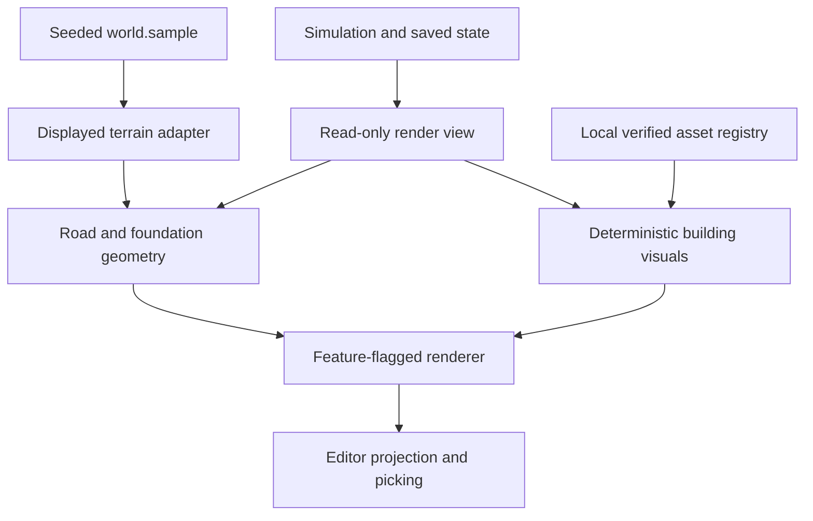

# ADR WV-ART-002A: mobile Three.js presentation migration

**Status:** implementation specification extending approved WV-ART-001. Research baseline `ae364169d7d3d3d30294fd8ce44c4c83dfc2b719`, 2026-10-31. No runtime changes in this PR.

## Decision and alternatives

Retain the approved **locally bundled, feature-flagged Three.js presentation adapter**. Use `WebGLRenderer` and `GLTFLoader`, preserve simulation/save/camera contracts, and integrate one vertical slice at a time. Keep the native WebGL renderer as the offline fallback throughout UAT. Pin one exact engine version and matching addons/decoders with a lockfile in the implementation PR; do not invent a version from memory or mix CDN revisions.

| Option | Benefit | Cost / reason |
| --- | --- | --- |
| Extend custom GLB parser | Small existing code path | Would require maintained hierarchy, texture, material, transform, picking, and lifetime support. It currently flattens imported color/geometry. Reject as primary asset path |
| Local Three.js adapter | Standard scene hierarchy/material loader and reusable batching; approved architecture | Adds engine bytes, WebGL2 requirement, and migration work. Chosen with parity and offline gates |
| Rewrite game or move to another engine | Broad tooling | Breaks incremental scope, touch controls, saves, and offline web delivery. Rejected |

The current Three.js [WebGLRenderer](https://threejs.org/docs/pages/WebGLRenderer.html) requires WebGL2. Detect capability before taking ownership of a canvas. The legacy implementation requests WebGL1; a canvas already bound to that context cannot simply become WebGL2. Use a replaceable canvas with identical ID, sizing, listeners, and overlay relationships on renderer switches, or choose the backend before first context creation. Dispose the old adapter first, preserve camera/state in the owner, and rebind input once. Test fallback both at boot and after context loss. No WebGPU requirement.

## Fresh baseline audit, including concurrently merged Track A

`develop` advanced during research from `9b074fc` through `ab5a1f6` (#58) to `ae36416` (#59 and #60). This branch rebased again before final delivery. Read the [terrain contact](../testing/WV-56-terrain-contact.md), [road authoring](../testing/WV-56-road-authoring.md), and [junction](../testing/WV-56-junctions.md) notes; preserve these completed pieces:

- `terrain-surface.mjs` exports `terrainResolution` and `createTerrainSurface`. It interpolates the **displayed b-d terrain triangles**, traces grid/diagonal crossings, and drapes convex polygons.
- `foundation-system.mjs` exports `resolveFoundation`. It samples perimeter and interior contacts, chooses `floor = max(height) + 0.8`, and returns corners, perimeter, relief, and flooded status.
- `road-surface.mjs` now samples actual authored quadratics and validates centerline and both 17-unit shoulders against analytic bounds, water, and the existing 1.55 slope/longitudinal grade limit. Failed curve edits preserve saved geometry/cost/logs. Preserve that rule; no new bridge type.
- `road-junctions.mjs` now trims road mouths into convex shared-node polygons and uses outward terminal semicircles. Pavement/shoulders share stations with deterministic edge variation. `game-3d-mesh.mjs` drapes these surfaces through the terrain adapter; old radial-overlap junctions have been superseded.
- Terrain contact, road surface, and junction unit tests plus browser terrain-contact scenes protect the implementation. Do not recreate these modules or regress to corner-only/chord-only sampling.
- Remaining work includes screen-space handles, full new-building footprint validation, extreme acute/self-intersecting curve UAT, legacy crossings without shared graph nodes, and local model integration. Existing saves remain playable. Review observed failures before further junction changes.

Other audited contracts: seven `BUILDINGS` keys; houses separate; `cottageBlueprint` variant 0–4 and founded-era dimensions; `buildingBlueprint` can fall back to current chapter; `mountWorld3D` is custom WebGL with native camera gesture helpers; `sw.js` caches optional modules best-effort; Pages workflow explicitly copies modules/galleries but **does not recursively copy future `assets/` or engine vendor directories**. Current external TGE GLBs are not a verified offline bundle. `build-offline.mjs` bundles JS/CSS but does not automatically embed fetched model data.

## Data flow and ownership



No arrow returns to simulation. Rendering must not call `ensureGraph`, `ensureCivic`, workforce setup, turn advancement, lane generation, save writes, or any helper that mutates its input. Existing read-like helpers may initialize state, so build the read view in the application owner, or operate on a disposable snapshot. Deep-freeze fixtures and compare serialized state before/after render-view construction as well as draw/update.

## Coordinate and terrain contract

Saved game point `{x,y}` maps to Three.js `{x: x-world.width/2, y: displayedHeight, z: y-world.depth/2}`. Up is +Y; saved Y becomes render Z. Inverse picking adds half extents and returns `{x,y}`. One game coordinate remains one render unit; model scale is explicit. No new elevation generator or saved terrain mutation.

Keep original analytic `world.sample` and `world.slope` authoritative for simulation suitability and water. The displayed adapter derives from those heights at the **same resolution and diagonal as the rendered mesh**. All contact meshes and picking share that adapter instance. On quality/resolution change, rebuild it and all dependent contact geometry together; no one-frame float or obsolete cache. A screen-space barycentric/ray triangle hit uses the actual terrain mesh, not an unrelated flat plane.

Reuse `drapePolygon` for convex pieces; concave house/plaza/road polygons must first be decomposed into convex parts. Clip paths/paving to valid dry land. Tolerances are proposed numerical checks: contact height error <=0.02 game units at sampled triangle interiors, foundation lower faces may extend 0.4 below contact to hide cracks, upper floors/eaves vary <=0.001 across a building. Retain current offsets until regression scenes justify a smaller one. Polygon offset can address coplanar flicker, but cannot repair intersections or mismatched heights.

## Target interfaces, adapt existing modules

The types below describe proposed interfaces; they do not change the save schema.

```ts
type Point2 = { x: number; y: number };
type Vec3 = [number, number, number];
type Facility = 'lumber' | 'farm' | 'smith' | 'park' | 'plaza' | 'market' | 'granary';
type Role = 'house' | Facility;
type AssetEntry = {
  id: string; catalogVersion: 1; role: Role | 'gallery-only';
  url: string; sha256: string; bytes: number; license: 'CC0-1.0' | 'original';
  sources: { archiveId: string; path: string; sha256: string }[];
  dependencies: { url: string; sha256: string; bytes: number }[];
  up: '+Y'; forward: '+Z'; pivot: 'floor-center';
  bounds: { min: Vec3; max: Vec3 }; footprint: Point2[];
  overhang: Point2[]; entrances: { position: Vec3; outward: Vec3; width: number }[];
  eras: number[]; lods: { url: string; sha256: string; triangles: number }[];
  triangles: number; primitives: number; instanceEligible: boolean; ready: boolean;
};
type VisualPlacement = {
  entityKey: string; assetId: string; uniformScale: number; yaw: number;
  origin: Vec3; floorY: number; footprintWorld: Point2[];
  entranceWorld: Vec3; approach: Point2[]; propTransforms: unknown[];
};
```

`asset-registry.mjs` validates entries, caches one parsed scene per URL/hash, tracks references, exposes async load status/errors, and owns disposal. `building-visuals.mjs` computes deterministic choices and placements from read-only state. `world-renderer-three.mjs` manages scenes and dirty updates. `editor-overlays.mjs` projects interaction targets independently. Reuse the existing `road-surface.mjs` authoring validator and `road-junctions.mjs` geometry builder instead of starting a parallel road graph. Extend `resolveFoundation` for composed footprints while keeping its current rectangular signature compatible.

### Normalize complete models

Khronos [glTF 2.0](https://registry.khronos.org/glTF/specs/2.0/glTF-2.0.html) specifies a right-handed Y-up coordinate system and hierarchical node transforms. Apply full scene transforms before measuring/baking. Preserve original modular origins during assembly; recenter **finished assemblies only** to floor-center. Use uniform scaling, outward +Z entrance, separate footprint/overhang polygons, and explicit doorway width/height. Door openings and safe approaches must be inspected in the gallery, not guessed from a model's bounding box.

A source Fantasy wall sits at +X (bounds X 0.4–0.5) and must be assembled on its cell boundary. Verify its exterior normal visually, then rotate the finished building's chosen facade to +Z. Existing 2D blueprint rotation uses `[cos,-sin;sin,cos]`; Three.js Y rotation uses the opposite sign in X/Z. Apply `rotation.y = -blueprint.orientation` after canonical normalization. Add a known-front test at all four cardinal directions so a model is never mirrored or turned away from `house.entrance`.

Store raw origin/bounds, normalization transform, canonical entrance, output SHA, and recipe version alongside each derivative. Source-manifest rows with `entranceVerified:false` must never enter a shipping `ready:true` registry directly. Reference-count shared textures/geometries. Preserve a fallback shell if model loading fails; do not write that fallback choice to a save.

### Roads, seats, and policy boundaries

Use existing road graph nodes/curves/widths and the current road-surface/junction modules. The current implementation samples curves by control-polygon length, trims mouths, fills a convex junction polygon, and drapes to displayed terrain triangles. Reuse it in Three.js. Verify acute joins, short segments, unequal widths, self-intersections, and legacy crossings before proposing a more general polygon union or adaptive sampler. Any improvement must preserve shared stations and topology and remain a focused geometry PR. Never replace graph connectivity with visual overlap inference.

A foundation is one horizontal seat over all contacts, with lower walls following perimeter creases. For concave footprints, subdivide before interior sampling, and retain doorway/porch anchors at the same floor. Derive plinth versus stepped courses from relief with a bounded visual policy; original rules do not yet define a new maximum foundation height. Do not make up a simulation rejection threshold in the renderer. If an old legal site is visually difficult, retain a safe legacy fallback and log a development diagnostic.

Road water/grade validation is now implemented in `road-surface.mjs` and its simulation call sites. Preserve it. Remaining full building footprint checks belong in **new authoring validation** using existing simulation policy, not silently introduced by asset selection. If a policy is absent (for example bridges), reject enabling that visual feature rather than inventing buildable bridge mechanics. Future validation changes require their own tests and legacy-save handling. No auto-bridge or road rerouting.

### Public API and input parity

Keep `mountWorld3D(canvas, world, options)` and its option callbacks. Preserve returned `setWorld`, `resetCamera`, `zoomBy`, `panBy`, `focusOn`, `homeView`, `navigateTouches`, `screenToWorld`, `setSettlement`, `render`, `setReference`, `assetStatus`, `getCamera`, and `dispose`. Compare arguments/results against current call sites before extraction.

Use an [OrthographicCamera](https://threejs.org/docs/pages/OrthographicCamera.html) with half-height equal to existing camera `zoom`, half-width `zoom * aspect`, Three.js zoom=1, and the existing focus/yaw/pitch mapping. Preserve focus elevation 17 and existing pitch/zoom clamps. Test asymmetric terrain and off-center focus, not only origin. Update projection on resize and viewport changes. Do not replace the proven gesture helper with OrbitControls during this migration.

[Raycaster](https://threejs.org/docs/pages/Raycaster.html) supports separate pick layers and reports `instanceId`. Pick the terrain for painting/road anchors and map instanced objects through a stable instance-to-entity table for inspection. Editor handles get priority through projected 44 CSS px hit boxes; their visible marks can stay small. DOM/pointer coordinates use the canvas client rect, never backing-buffer/device pixels. Camera gestures and pan mode keep their current ownership and cancellation rules.

## Materials, batching, and lifetime

[GLTFLoader](https://threejs.org/docs/pages/GLTFLoader.html) preserves glTF scenes/materials and supports the inspected texture-transform/unlit extensions. Use matching local addons. Supply a LoadingManager and resolve local dependencies with URLs relative to `import.meta.url` or a branch-local asset base, avoiding root-relative paths that escape `/Willow-Valley/dev/`. Never request a decoder unless the optimized output actually needs it.

Apply [Three.js color management](https://threejs.org/manual/pages/color-management.html): sRGB color textures, linear lighting, sRGB output, non-color maps without color-space conversion. Avoid double conversion of existing linear vertex colors. Start with authored glTF matte materials and deliberate palette derivatives; test unlit Nature against lit buildings under the shared art light before overriding it.

Bake repeated static house recipes into one or a few geometry/material groups per variant, then use [InstancedMesh](https://threejs.org/docs/pages/InstancedMesh.html) per geometry/material and spatial chunk. A multi-mesh model does not become one draw call merely by sharing an ID. Update instance matrices only on placement changes, mark dirty buffers, and refresh bounds after changes. Keep stable instance IDs for picking; do not instance animated hinges/smoke in the same static batch. Never rebuild all terrain or houses on camera motion.

Render on dirty state/camera/resize/assets, using one scheduled rAF; bounded cosmetic effects may keep it running only while visible. Stop on hidden tab and resume safely. Explicitly dispose geometry, materials, textures, render targets, and listeners when last references are released. [Three.js disposal guidance](https://threejs.org/manual/pages/how-to-dispose-of-objects.html) also requires separate handling for image bitmaps. Cancellation/generation tokens must prevent an old async load from attaching after slot/world switches.

## Offline and packaging contract

Adopt same-origin, content-addressed model/texture/engine files. Generate a required install list from the final registry, including engine/addons and dependencies. The installed 3D game is offline-ready only after that entire required set is fetched and validated. The current optional-cache path swallows failures and is insufficient for this promise. [Cache.addAll](https://developer.mozilla.org/en-US/docs/Web/API/Cache/addAll) rejects on failed requests; treat failed install as incomplete and retain the previous complete cache. Implement an explicit ready status and retry while preserving saves.

Before shipping assets, extend Pages packaging to recursively copy branch-local `assets/` and local engine bundles into **both branch destinations** as applicable. Verify the published URL layout under both root and `/dev/`. Required engine/model requests must not fall through to HTML on a 404. Use a coherent versioned cache and immutable hashes so network-first module updates cannot pair a new registry with an old missing texture. Test interrupted upgrade and existing install rollback.

The standalone `offline.html` is a separate artifact. Its existing JS bundler leaves dynamic fetched binaries external. Extend it to embed the same required models/textures/engine with a local byte resolver, or preserve its legacy renderer until a separately approved packaging change. Preserve currently supported standalone gameplay; never advertise model-complete standalone HTML without a file-URL/network-disabled test. The PWA must ship the complete selected 3D catalog regardless of this legacy export fallback.

## Proposed budgets, not measured phone claims

| Metric | Normal target | Low target / remedy |
| --- | --- | --- |
| Moving-camera frame pacing | Sustained 30 FPS; median frame <=33.3 ms, p95 <=50 ms over 60 s after warm-up | Reduce shadow cost, density, and DPR first |
| Draw calls, 100-house scene plus facilities/terrain/nature | <=150 total including shadow passes | <=100; reduce chunks/material splits |
| Visible triangles | <=250k normal scene | <=150k; props/trees LOD first |
| Home LOD0 / LOD1 | <=2,000 / 600 triangles per assembled variant | Share material groups, remove hidden/internal faces |
| Facility LOD0 / LOD1 | <=4,000 / 1,200 triangles including identifying dressing | Retain identity silhouette and paths |
| Home / facility output size | <=200 KiB / 400 KiB GLB, excluding shared textures | Measure and optimize generated outputs |
| All required engine + catalog + textures | <=8 MiB transfer and <=16 MiB uncompressed cached files, incremental to current shell | No unreviewed full-pack import |
| DPR / shadows | DPR <=1.5, one bounded 1024² shadow map if it fits frame budget | DPR 1, shadows/smoke/tiny props off |
| Texture and geometry memory | Estimate <=48 MiB texture allocations, <=32 MiB geometry; measure real allocations where available | No full-resolution diffuse photos, repeated decoders, or duplicate palettes |

`renderer.info` exposes draw/triangle/resource counts, not accurate total GPU or JS memory bytes. Use known buffer/texture sizes for estimates and device tools where available; label unavailable Safari counters. Log device model, OS/browser, CSS viewport, DPR, quality, world seed, scene, commit, warm-up, duration, median/p95/p99 frame intervals, load/parse times, bytes, and thermal conditions. Physical iPhone Duo measurements remain required; desktop emulation is not phone performance evidence.
