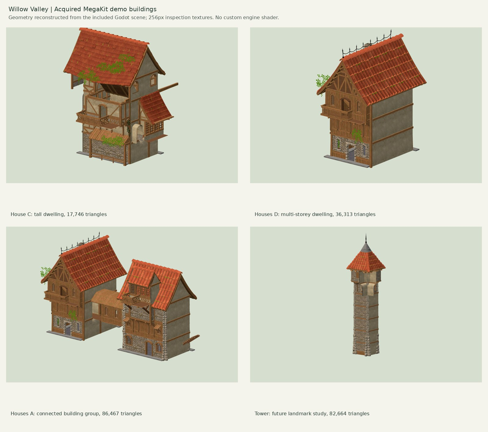

# WV-ART-004: acquired Medieval Village MegaKit audit

**Inspected:** 2026-10-31, from `develop` commit `604a2272a38e02c539027d2611d0d059b1370e76`.
**Decision:** admit the acquired source art as a **CC0-evidenced, selectively imported modular building source**. Start with small authored cottages, farmhouse, and workshop shells. Keep the current functional yard props and all simulation contracts. The demo's complete building arrangements are later-town studies, not drop-in founding homes. This research changes no runtime code or saves.

**Latest develop compatibility review:** `2920b0fa35c012fe30e3622fcef7b44b0145719b` added WV-ART-003 S2 meadow/soil/slope rendering while this audit was in progress. Its changes do not alter the building, identity, parcel or save contracts described here. The delivery branch includes that commit. Recorded full-suite results remain explicitly tied to the tested `604a227` baseline; CI validates the combined documentation branch.

## Acquisition and evidence

The user-supplied iCloud share was accessible without sign-in. Downloaded `Medieval Village MegaKit[Source].zip`: **708,720,797 bytes**, SHA-256 `5e60888e2babe418a4618e7815539d9b1b2c3b24c1db2b22cd7a2a7f66140732`. This is 708.7 decimal MB or 675.9 MiB. The original archive and extracted model files remain outside the repository. The private share URL and download tokens are intentionally omitted from public documentation.

The outer archive expands to **804,698,551 bytes**, including the three still-compressed engine projects. It contains 3,138 files plus 10 directory entries. Inventorying the engine archives adds 4,049 files, giving **7,187 file records**. Every file was read and hashed. All canonical glTF geometry was parsed and measured, not inferred from screenshots or vendor marketing counts. Engine projects were inspected as data; their scripts were not executed. Engine scene/package binaries were not reverse-engineered.

| Content | Verified result |
| --- | --- |
| Canonical `glTF/` | 304 unique named source modules, 304 `.gltf` plus 304 `.bin` files; all referenced external dependencies present |
| `OBJ/`, `FBX/`, `FBX (Unreal Engine)/` | Each contains the same 304 named exports; these are format variants, not additional building designs |
| `FBX (Unity)/` | 304 visual exports plus 293 separately named collision exports |
| `glTF (Godot)/` | 305 exports; the extra item is sample-scene ground, not a house |
| Blender | One `MedievalVillage_AllModels.blend` authoring collection, not a catalog of 304 completed houses |
| Godot project | 305 glTF exports, one 933-node sample scene, materials/import settings, and a CC0-noticed import script |
| Unity project | 304 prefabs, all named after the same source modules; a sample village scene, collisions, shaders, and editor/package tooling |
| Unreal project | 304 named model `.uasset` files; the other 58 `.uasset` files are materials, textures, or landscape data; one `.umap` sample scene |
| Loose complete buildings | **Zero** verified self-contained house/farm/smith/granary model files |
| Assembled demo content | Five named building groups, with House C2 duplicating House C; four distinct arrangements |

The canonical geometry totals **240,684 triangles**, ranging from 4 to 6,356 triangles per module. No canonical glTF animation was found. The count includes detailed doors and roofs; it is not a proposed runtime scene budget.

### Modular categories

| Category | Count | Category | Count |
| --- | ---: | --- | ---: |
| Roof | 109 | Wall | 32 |
| Overhang | 38 | Prop | 26 |
| Stairs | 21 | Window | 18 |
| Door | 16 | Floor | 13 |
| Corner | 8 | Shutter | 8 |
| Door frame | 6 | Closure | 5 |
| Balcony | 4 | **Total** | **304** |

## Complete historical building arrangements

These are reconstructions of the actual `Engine Projects/Godot.zip` scene `Godot/addons/quaternius/medievalvillagemegakit/L_SampleScene_1.tscn`. Direct group children reference modules with authored transforms. Measurements exclude each group's placement in the demo village and all collision-only child meshes. Full recipes, matrices, exact nested paths, and canonical equivalent source filenames are in [demo-assemblies.json](../assets/wv-megakit/demo-assemblies.json).

Images use actual glTF materials with temporary 256-pixel inspection copies of their textures. They do not reproduce the Godot/Unity custom wear shader, vendor lighting, or a final Willow Valley palette. No inspection texture is included in the repository. Visual reconstruction agreed with the independent CPU bounds to within 0.00001 authoring units. Source groups are architectural examples, not historically certified reconstructions.

| Source group | Size, X × Y × Z, authoring units | Placed modules | Triangles | Distinct module names | Recommendation |
| --- | --- | ---: | ---: | ---: | --- |
| House C | 13.976 × 16.918 × 14.940 | 167 | 17,746 | 49 | Best irregular timber/plaster/stone composition study; retain roof and balcony ideas for later eras. Tall, projecting arrangement needs curated closure, entrance, and support checks |
| House C2 | Same as House C | 167 | 17,746 | 49 | Exact geometry/transform recipe duplicate; different village placement does not make a second silhouette |
| Houses D | 9.823 × 15.034 × 12.002 | 151 | 36,313 | 41 | Clear multi-storey townhouse front; candidate for later urban frontage or a future inn visual. Requires ground-door completion and optimization |
| Houses A | 27.283 × 15.042 × 13.002 | 308 | 86,467 | 67 | Connected multi-volume block, not one household. Useful for studying accumulated frontage, not a valid current residential replacement |
| Tower | 8.000 × 29.853 × 8.000 | 77 | 82,664 | 8 | Later landmark study only. Repeated detailed masonry makes it expensive despite only eight unique module names. No new gameplay type |

At the proposed common scale of 2.8 game units per inferred metre, House C would occupy about **39.1 × 41.8 game units** before placement margins. Current founding home envelopes are only **17–24 × 19–25**. Houses D would occupy **27.5 × 33.6**, also too large. Uniformly shrinking either to fit would make their doors and implied inhabitants inconsistent with the rest of the town. Do not assign the tower as a granary, or relabel the connected block as a farm.

The source demo supplies richer facades than the current shells, but also unused interiors, repeated pieces, projecting trim, tall stacks, and multiple material groups. Exporting a demo group unchanged would not constitute an optimized or placement-ready game asset.

## Licensing decision for this exact archive

The unmodified [License_Source.txt](../assets/wv-megakit/License_Source.txt), SHA-256 `7310dfa8512d7ca12b6591329fda4adab7e8b9cdbe04c7d7061c2fe5c7dc38ee`, identifies the Source tier, credits Quaternius, and explicitly declares **CC0 1.0 Universal**. The [official pack page](https://quaternius.com/packs/medievalvillagemegakit.html) and [creator's itch.io listing](https://quaternius.itch.io/medieval-village-megakit) both identify this pack as CC0 when checked. [Creative Commons' CC0 deed](https://creativecommons.org/publicdomain/zero/1.0/) permits copying, modification, distribution, and commercial use, subject to its stated exclusions.

The [current generic Quaternius license page](https://quaternius.com/license.html) instead publishes QAL v1.0 dated 2026-08-28, restricting standalone redistribution. Its scope refers to assets released under that license, and section 7 says license updates do not apply retroactively. The newly inspected, pack-specific CC0 notice supplies evidence missing from WV-ART-002A's earlier deferral. **Our repository admission decision is to rely on the explicit notice attached to this hash and corroborating pack-specific publisher listings for selected art.** This is a scoped provenance decision, not a claim that every current or future Quaternius release is CC0, or a guarantee concerning third-party rights.

The license files are inconsistent across the publisher's website, so every future source revision must be checked again. Do not substitute a new archive under the same pack name and reuse this conclusion. Preserve the acquisition hash, attached notice, and exact derivative inputs in the build manifest. Do not infer an original purchase date from ZIP timestamps.

### Engine-project exceptions

The nested Unity project includes `Quaternius/Packages/com.unity.asset-store-tools/LICENSE.md`, SHA-256 `406511460a2d13c693241ca3602c1bc2b846f05794ddee88f34a24ba34d903f1`. It names the Unity Companion License for source and Unity Package Distribution License otherwise. Therefore **the archive is not a blanket CC0 license grant for all embedded software**. The Godot import script separately contains a CC0 notice; neither script is needed for our Three.js runtime.

Exclude **all engine projects, package/editor code, `.cs`, `.gd`, shaders, engine metadata, imported caches, collisions, `.blend`, FBX, OBJ, and vendor scene files** from a runtime asset commit. Unity/Godot wear shaders need original Willow Valley material treatment or offline baking, not a pasted engine implementation. The original archive must never be committed, including via Git LFS. This research PR contains metadata, license evidence, recipes, and rendered comparisons only, with no model or texture binaries. Selected optimized art derivatives may be committed in a later narrowly reviewed change after per-output provenance checks.

## Recommended source shortlist

[shortlist.json](../assets/wv-megakit/shortlist.json) pins **38 exact source modules**, hashes, measurements, dependencies, triangle counts, and intended roles. Every filename below is relative to the archive's `glTF/` directory and ends in `.gltf`; matching `.bin` and referenced images must be resolved too. None is a completed building by itself.

| Priority | Inputs | Intended replacement |
| --- | --- | --- |
| First | `Wall_Plaster_Straight`, `Wall_Plaster_Door_Flat`, `Wall_Plaster_Window_Thin_Round`, `Wall_WoodWear_Straight`, `Wall_WoodWear_Door_Flat`, `Wall_WoodWear_Window_Thin_Round`, `Corner_Exterior_Wood`, `Corner_Exterior_Brick`, `Floor_WoodDark` | Authored closed cottage and workplace shells; replace the building envelope while retaining existing functional composition |
| First | `Door_1_Flat`, `Door_1_Round`, `DoorFrame_Flat_WoodLight`, `DoorFrame_Round_WoodDark`, `Window_Thin_Round1`, `Window_Wide_Flat1`, `WindowShutters_Thin_Round_Open` | Human-scale door/window vocabulary; first door is 314 triangles, versus over 6,000 for `Door_2_Flat`/`Door_2_Round` |
| First | `Roof_FlatTiles_4x4`, `Roof_RoundTiles_4x4`, `Roof_FlatTiles_4x6`, `Roof_RoundTiles_4x6`, `Roof_Front_Wood4` | Four complete roof components for compact houses; measured extents include generous overhangs, so nominal 4×4 is not the collision envelope |
| First | `Roof_Wooden_2x1`, `Roof_Wooden_2x1_Center`, `Roof_Wooden_2x1_L`, `Roof_Wooden_2x1_R`, `Prop_Support` | Porch, barn or open work-shelter roof assemblies. Use new side/end closures and posts where required |
| Second | `Wall_UnevenBrick_Straight`, `Wall_UnevenBrick_Door_Flat`, `Prop_Chimney2`, `Prop_Crate`, `Prop_Wagon` | Smith masonry/vent, granary base/loading yard, market goods. Retain existing anvil/forge/log props. `Prop_Chimney2` is 130 triangles versus 618 for `Prop_Chimney` |
| Second | `Prop_WoodenFence_Single`, `Prop_WoodenFence_Extension1`, `Prop_WoodenFence_Extension2` | Shared yard boundary vocabulary, outside entry corridors |
| Optional close detail | `Balcony_Simple_Straight`, `Balcony_Simple_Corner`, `Prop_Vine1`, `Stairs_Exterior_Straight` | Later frontage and selective accents; remove vines/balconies from founding low quality; stairs must match the actual foundation rise |

## Replacement crosswalk against current develop

The old handoff's statement that the game has no Three.js adapter or imported building assemblies is now stale. This baseline has `world-renderer-three.mjs`, deterministic `building-visuals.mjs`, six Kenney-based homes, all seven facility compositions, instancing via `scene-batches.mjs`, local asset loading, and integrity-checked caching. The latest refresh also includes WV-ART-003 S1 ground textures and `environment-materials.mjs`. Match the new facade palette against that terrain treatment. Those are the integration points. Native WebGL still uses `game-3d-mesh.mjs` procedural geometry when models are unavailable. Inspect the actual branch again before implementation.

| Current visual | Existing model triangles | Recommended action | Preserve |
| --- | ---: | --- | --- |
| Six `home-*` models | 518–650 each | Build six compact MegaKit-based counterparts; start with a 4×4 plaster cottage as one optional gallery slice. Keep six existing stable identities and procedural fallback | Households, coordinates, founding era/turn, parcels, entrance and deterministic selection |
| `facility-farm` | 658 | Replace farmhouse shell with a compatible small cottage; add a wooden lean-to roof to the existing barn/yard composition | Painted farmland mask, crop exclusion, staffing, yield, shared-field deduplication |
| `facility-lumber` | 372 | Retain open shelter/log yard. Optional wooden roof, fences, crates, wagon improve read; a tall townhouse is unsuitable | Log stocks, labor, road access, low open silhouette |
| `facility-smith` | 1,160 | Strong replacement candidate: plaster/timber front, brick work bay, cheaper masonry chimney. Keep anvil/hearth from current assembly | Forge identity, approach, production and costs; no invented fuel simulation |
| `facility-granary` | 480 | Author boarded store with raised dry platform and loading door from selected modules; source demo tower is inappropriate | Existing capacity, unlock and staffing; loading path fits current site |
| `facility-market` | 1,250 | Retain separated open stalls. Add restrained crate/wagon props only if clearance and human scale agree | Open circulation, four-worker target, access and unlock |
| `facility-plaza` | 192 | Retain terrain-conforming open paving and perimeter seating; no building replacement | Ground-space treatment, routes and foundation contacts |
| `facility-park` | 534 | Retain commons and nature assets; optional low fence at clear perimeter | Open space, nature rules, paths and walkable entry |

Source materials have more painted detail and richer relief than the Kenney palette. Keep warm off-white infill, dark structural timber, muted terracotta roofs, and subdued gray masonry. Reduce saturated orange roofs and bright vines offline. Keep variation in roof form and wall family, rather than random material switching. This kit has no verified thatch roof or dedicated forge, anvil, grain sack, hay bale, market stall, complete barn, complete granary, chapel, or mill. Existing CC0 assets and original authored geometry remain necessary.

## Texture and performance implications

There are 100 outer PNG files but **51 distinct hashes**, totaling **133,667,219 compressed bytes** after deduplication. Many are duplicated across export directories. Eighty-four are 2048×2048, four are 4096×4096, and the remainder are 128–1024 square. These counts include export/engine texture variants, not 51 textures every house needs. A single 2048 RGBA8 image is 16 MiB decoded, about 21.3 MiB with a full mip chain; PNG download size does not predict GPU memory.

Use only the dependencies of selected outputs. An initial exterior-only house should target 2,000–4,000 triangles, at most three material groups, and shared 512–1024-pixel textures. These are proposed budgets, not measured performance claims. The existing 518–650-triangle homes set a much cheaper baseline. Even House C's 17,746 triangles are roughly 27–34 times a current house before interior removal and simplification. Source balconies, doors, and roof tiles can dominate cost without improving normal mobile zoom.

Shared textures must remain shared through the build and loader lifetime. Embedding identical texture bytes independently in every GLB may still allocate multiple textures and defeat material batching. Prove canonical texture/material reuse, or use one shared glTF buffer/image bundle with a deliberately extended manifest. [The Codex handoff](../handoffs/WV-ART-004-megakit-codex.md) defines admission and scale gates. No runtime rollout is authorized by these illustrative budgets.

## Evidence index

- [Inventory and reproduction instructions](../assets/wv-megakit/README.md)
- [All 7,187 file records](../assets/wv-megakit/all-files.csv), including containers, sizes, hashes and model-container flags
- [304 source modules, compact CSV](../assets/wv-megakit/models.csv), [full measured records](../assets/wv-megakit/models.json)
- [Godot export variants](../assets/wv-megakit/godot-variants.json), [texture inventory](../assets/wv-megakit/textures.json)
- [Source demo assembly recipes](../assets/wv-megakit/demo-assemblies.json)
- [License findings](../assets/wv-megakit/license-findings.json), [exact attached CC0 notice](../assets/wv-megakit/License_Source.txt)
- [Human-scale and integration handoff](../handoffs/WV-ART-004-megakit-codex.md)

Public corroboration: [pack-specific publisher page](https://quaternius.com/packs/medievalvillagemegakit.html), [creator's listing](https://quaternius.itch.io/medieval-village-megakit), [generic QAL](https://quaternius.com/license.html), [CC0 deed](https://creativecommons.org/publicdomain/zero/1.0/), [CC0 legal code](https://creativecommons.org/publicdomain/zero/1.0/legalcode.en). Pack-specific statements and archive contents govern this recommendation; generic marketing or the archive price alone do not establish redistribution permission.
